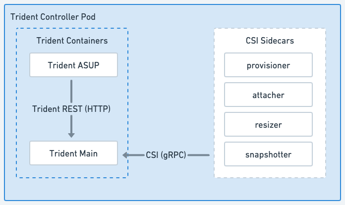

= Tridentアーキテクチャ
:hardbreaks:
:allow-uri-read: 
:icons: font
:imagesdir: ../media/

[role="lead"]
Tridentは、クラスター内の各ワーカーノード上で、単一のControllerポッドとNodeポッドとして実行されます。ノードポッドは、Tridentボリュームをマウントする可能性のあるホスト上で実行されている必要があります。

[[understanding-controller-pods-and-node-pods]]
== コントローラポッドとノードポッドについて

Tridentは、Kubernetesクラスタ上で単一の<<Tridentコントローラポッド>>と1つ以上の<<Trident ノードポッド>>として展開され、標準のKubernetes _CSI Sidecar Containers_を使用してCSIプラグインの導入を簡素化します。link:https://kubernetes-csi.github.io/docs/sidecar-containers.html["Kubernetes CSI サイドカーコンテナ"^]は、Kubernetes Storageコミュニティによってメンテナンスされています。

Kuberneteslink:https://kubernetes.io/docs/concepts/scheduling-eviction/assign-pod-node/["ノードセレクター"^]およびlink:https://kubernetes.io/docs/concepts/scheduling-eviction/taint-and-toleration/["tolerations と taints"^]は、ポッドを特定のノードまたは優先ノードで実行するように制限するために使用されます。Trident のインストール時に、コントローラーとノードポッドのノードセレクターと許容値を設定できます。

* コントローラー プラグインは、スナップショットやサイズ変更などのボリュームのプロビジョニングと管理を処理します。
* ノード プラグインは、ストレージをノードに接続する処理を行います。

.Kubernetes クラスタに Trident を導入済み
image::../media/trident-arch.png[Kubernetes クラスタ上の Trident アーキテクチャの図。]

[[trident-controller-pod]]
=== Tridentコントローラポッド

Trident Controller Pod は、CSI Controller プラグインを実行する単一のポッドです。

* NetApp ストレージでのボリュームのプロビジョニングと管理を担当
* Kubernetes Deployment によって管理
* インストール パラメータに応じて、コントロール プレーンまたはワーカー ノードで実行できます。

.Trident コントローラポッドの図

[[trident-node-pods]]
=== Trident ノードポッド

Trident Node Pod は、CSI Node プラグインを実行する特権 Pod です。

* ホスト上で実行されている Pod のストレージのマウントとアンマウントを担当します
* Kubernetes DaemonSetで管理
* NetApp ストレージをマウントするすべてのノードで実行する必要があります

.Trident ノードポッド図
image::../media/node-pod.png[適用可能な CSI サイドカーを備えた CSI Node プラグインを実行する Trident Node Pod の図。]

[[supported-kubernetes-cluster-architectures]]
== サポートされている Kubernetes クラスタアーキテクチャ

Tridentは次の Kubernetes アーキテクチャでサポートされています：

[cols="3,1,2"]
|===
| Kubernetes クラスタアーキテクチャ | サポート | デフォルトインストール 

| シングルマスター、コンピューティング | はい  a| 
はい

| 複数のマスター、コンピューティング | はい  a| 
はい

| マスター、 `etcd`、計算 | はい  a| 
はい

| マスター、インフラ、コンピューティング | はい  a| 
はい

|===