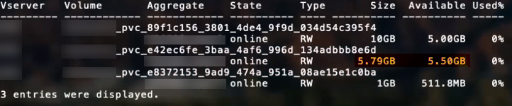

= ONTAP SAN 構成オプションと例
:hardbreaks:
:allow-uri-read: 
:icons: font
:imagesdir: ../media/

[role="lead"]
ONTAP SAN ドライバーを作成してTridentインストールで使用します。このセクションでは、バックエンド構成の例と、バックエンドをStorageClassesにマッピングするための詳細について説明します。link:https://docs.netapp.com/us-en/asa-r2/get-started/learn-about.html["ASA r2システム"^]は、ストレージ レイヤの実装において、他のONTAPシステム（ASA、AFF、およびFAS）とは異なります。これらの違いは、記載されている特定のパラメータの使用に影響します。link:https://docs.netapp.com/us-en/asa-r2/learn-more/hardware-comparison.html["ASA r2システムとその他のONTAPシステムの違いについて詳しくは、こちらをご覧ください"^]。Tridentバックエンド構成では、システムがASA r2であることを指定する必要はありません。 `ontap-san`を `storageDriverName`として選択すると、TridentはASA r2またはその他のONTAPシステムを自動的に検出します。以下の表に示すように、一部のバックエンド構成パラメータはASA r2システムには適用されません。

NOTE:  `ontap-san`ドライバー（iSCSI、NVMe/TCP、FCプロトコル）のみがASA r2システムでサポートされています。

[[backend-configuration-options]]
== バックエンド構成オプション

26.06 リリース以降、ONTAP バランスの取れた配置を有効にすることで、ONTAP が新しいボリュームのアグリゲートを選択できるようになります。要件と例については、link:ontap-balanced-placement.html["ONTAPバックエンドでバランスの取れた配置を使用する"] を参照してください。

バックエンド構成オプションについては、次の表を参照してください：

[cols="1,3,2"]
|===
| パラメータ | 概要 | デフォルト 

| `version` |  | 常に1 

| `storageDriverName` | ストレージドライバの名前。作成後は変更できません。このパラメータを更新するには、新しいバックエンドを作成する必要があります。 | `ontap-san` または `ontap-san-economy` 

| `backendName` | カスタム名またはストレージバックエンド | ドライバー名 + "_" + dataLIF 

| `managementLIF`  a| 
クラスタまたは SVM 管理 LIF の IP アドレス。

完全修飾ドメイン名（FQDN）を指定できます。

Trident が IPv6 フラグを使用してインストールされている場合、IPv6 アドレスを使用するように設定できます。IPv6 アドレスは角括弧で定義する必要があります。例： `[28e8:d9fb:a825:b7bf:69a8:d02f:9e7b:3555]`。

シームレスなMetroClusterスイッチオーバーについては、<<mcc-best>>を参照してください。

NOTE: 「vsadmin」の資格情報を使用している場合は、 `managementLIF` SVMのものでなければなりません。「admin」の資格情報を使用する場合は、 `managementLIF` クラスターのものである必要があります。
| "10.0.0.1"、"[2001:1234:abcd::fefe]" 

| `dataLIF` | プロトコル LIF の IP アドレス。Trident が IPv6 フラグを使用してインストールされている場合、IPv6 アドレスを使用するように設定できます。IPv6 アドレスは角括弧で定義する必要があります。例： `[28e8:d9fb:a825:b7bf:69a8:d02f:9e7b:3555]`。*iSCSI の場合は指定しないでください。*Trident はlink:https://docs.netapp.com/us-en/ontap/san-admin/selective-lun-map-concept.html["ONTAP セレクティブLUNマップ"^]を使用して、マルチパス セッションを確立するために必要な iSCSI LIF を検出します。警告が発生するのは、 `dataLIF`が明示的に定義されている場合です。*MetroCluster の場合は省略します。*<<mcc-best>>を参照してください。 | SVMによって導出された 

| `svm` | 使用するストレージ仮想マシン *MetroCluster の場合は省略。*<<mcc-best>>を参照してください。 | SVM `managementLIF`が指定されている場合に導出されます 

| `useCHAP` | ONTAP SAN ドライバーの iSCSI 認証に CHAP を使用します [ブール値]。 `true`に設定すると、バックエンドで指定された SVM のデフォルト認証として、Trident が双方向 CHAP を設定して使用します。詳細については、link:ontap-san-prep.html["ONTAP SANドライバを使用してバックエンドを設定する準備をします"]を参照してください。*FCP または NVMe/TCP ではサポートされません。* | `false` 

| `chapInitiatorSecret` | CHAP イニシエータシークレット。次の場合は必須 `useCHAP=true` | "" 

| `labels` | ボリュームに適用する任意の JSON 形式のラベルのセット | "" 

| `chapTargetInitiatorSecret` | CHAP ターゲット イニシエータ シークレット。次の場合は必須 `useCHAP=true` | "" 

| `chapUsername` | 受信ユーザー名。次の場合は必須 `useCHAP=true` | "" 

| `chapTargetUsername` | ターゲットユーザー名。次の場合は必須 `useCHAP=true` | "" 

| `clientCertificate` | クライアント証明書の Base64 エンコードされた値。証明書ベースの認証に使用 | "" 

| `clientPrivateKey` | クライアント秘密キーの Base64 エンコードされた値。証明書ベースの認証に使用 | "" 

| `trustedCACertificate` | 信頼された CA 証明書の Base64 エンコードされた値。任意。証明書ベースの認証に使用されます。 | "" 

| `username` | ONTAP クラスタとの通信に必要なユーザー名。クレデンシャルベースの認証に使用されます。Active Directory 認証については、link:../trident-use/ontap-san-examples.html#authenticate-trident-to-a-backend-svm-using-active-directory-credentials["Active Directory の認証情報を使用してバックエンド SVM に Trident を認証"]を参照してください。 | "" 

| `password` | ONTAP クラスタとの通信に必要なパスワード。クレデンシャルベースの認証に使用されます。Active Directory 認証については、link:../trident-use/ontap-san-examples.html#authenticate-trident-to-a-backend-svm-using-active-directory-credentials["Active Directory の認証情報を使用してバックエンド SVM に Trident を認証"]を参照してください。 | "" 

| `svm` | 使用するStorage Virtual Machine | SVM `managementLIF`が指定されている場合に導出されます 

| `storagePrefix` | SVMで新しいボリュームをプロビジョニングする際に使用されるプレフィックス。後から変更することはできません。このパラメータを更新するには、新しいバックエンドを作成する必要があります。 | `trident` 

| `aggregate`  a| 
プロビジョニング用のアグリゲート（オプション。設定する場合は、SVMに割り当てる必要があります）。 `ontap-nas-flexgroup`ドライバーの場合、このオプションは無視されます。割り当てられていない場合は、利用可能なアグリゲートのいずれかを使用してFlexGroupボリュームをプロビジョニングできます。

NOTE: SVM でアグリゲートが更新されると、Trident コントローラを再起動することなく、SVM をポーリングすることで Trident に自動的に反映されます。Trident でボリュームをプロビジョニングするために特定のアグリゲートを設定している場合、そのアグリゲートの名前が変更されたり SVM から移動されたりすると、SVM アグリゲートのポーリング中にバックエンドが Trident で失敗状態に移行します。バックエンドをオンラインに戻すには、アグリゲートを SVM 上に存在するものに変更するか、完全に削除する必要があります。

*ASA r2システムには指定しないでください*。

* `useBalancedPlacement`が `true`に設定されている場合は指定しないでください。*
 a| 
""

| `useBalancedPlacement`  a| 
新しいボリュームのアグリゲート選択を ONTAP に委任します [Boolean]。ONTAP 9.19.1 以降が必要で、 `useREST` を  `true` に設定する必要があります。 `aggregate` と組み合わせることはできません。

要件と例については、link:ontap-balanced-placement.html["ONTAPバックエンドでバランスの取れた配置を使用する"] を参照してください。
| `false` 

| `limitAggregateUsage` | 使用率がこのパーセンテージを超える場合、プロビジョニングは失敗します。Amazon FSx for NetApp ONTAP バックエンドを使用している場合は、 `limitAggregateUsage`を指定しないでください。提供された `fsxadmin`と `vsadmin`には、Trident を使用してアグリゲートの使用状況を取得して制限するために必要な権限が含まれていません。*ASA r2システムには指定しないでください*。 | ""（デフォルトでは強制されません） 

| `limitVolumeSize` | 要求されたボリューム サイズがこの値を超える場合、プロビジョニングは失敗します。また、LUNに対して管理するボリュームの最大サイズも制限します。 | ""（デフォルトでは強制されません） 

| `lunsPerFlexvol` | FlexVolあたりの最大LUN数は[50, 200]の範囲でなければなりません | `100` 

| `debugTraceFlags` | トラブルシューティング時に使用するデバッグ フラグ。例：{"api":false, "method":true}トラブルシューティングを行っており、詳細なログ ダンプが必要な場合を除き、使用しないでください。 | `null` 

| `useREST`  a| 
ONTAP REST APIを使用するためのブーリアン パラメータ。

 `useREST`に設定すると `true`、TridentはONTAP REST APIを使用してバックエンドと通信します。 `false`に設定すると、TridentはONTAPI（ZAPI）呼び出しを使用してバックエンドと通信します。この機能にはONTAP 9.11.1以降が必要です。さらに、使用するONTAPログインロールには、 `ontapi`アプリケーションへのアクセス権が必要です。これは、事前定義された `vsadmin`および `cluster-admin`ロールで満たされます。Trident 24.06リリースおよびONTAP 9.15.1以降では、 `useREST`はデフォルトで `true`に設定されます。ONTAPI（ZAPI）呼び出しを使用するには、 `useREST`を `false`に変更します。

`useREST`は、NVMe/TCP に完全対応しています。

NOTE: NVMeはONTAP REST APIでのみサポートされ、ONTAPI（ZAPI）ではサポートされていません。

*指定されている場合は、常に ASA r2 システムの `true`に設定します*。
| ONTAP 9.15.1以降の場合は`true`、それ以外の場合は `false`。 

 a| 
`sanType`
| iSCSIの場合は `iscsi`、NVMe/TCPの場合は `nvme`、SCSI over Fibre Channel（FC）の場合は `fcp`を選択します。 | `iscsi` 空白の場合 

| `formatOptions`  a| 
 `formatOptions`を使用して、ボリュームがフォーマットされるたびに適用される `mkfs`コマンドのコマンドライン引数を指定します。これにより、ボリュームをお客様の好みに合わせてフォーマットできます。デバイスパスを除き、mkfsコマンドのオプションと同様にformatOptionsを指定してください。例：「-E nodiscard」

* `ontap-san`および `ontap-san-economy`ドライバでiSCSIプロトコルを使用する場合にサポートされます。**さらに、iSCSIおよびNVMe/TCPプロトコルを使用する場合、ASA r2システムでサポートされます。*
 a| 

| `limitVolumePoolSize` | ontap-san-economy バックエンドで LUN を使用する場合の最大リクエスト可能 FlexVol サイズ。 | ""（デフォルトでは強制されません） 

| `denyNewVolumePools` | バックエンドが LUN を格納する新しい FlexVol ボリュームを作成できないように制限 `ontap-san-economy`します。新しい PV のプロビジョニングには、既存の FlexVol のみが使用されます。 |  
|===

[[recommendations-for-using-formatoptions]]
=== formatOptionsの使用に関する推奨事項

Tridentは、フォーマット処理を高速化するために次のオプションを推奨します：

* *-E nodiscard （ext3、ext4）：* mkfs実行時にブロックを破棄しないでください（最初にブロックを破棄することは、ソリッドステートデバイスやスパース/シンプロビジョニングストレージで有用です）。これは非推奨となったオプション「-K」に代わるもので、ext3、ext4ファイルシステムに適用可能です。
* *-K (xfs)：* mkfs実行時にブロックを破棄しません。このオプションは、xfsファイルシステムに適用されます。

[[authenticate-trident-to-a-backend-svm-using-active-directory-credentials]]
=== Active Directory の認証情報を使用してバックエンド SVM に Trident を認証

Tridentを設定して、Active Directory（AD）認証情報を使用してバックエンドSVMに認証できます。ADアカウントがSVMにアクセスする前に、クラスターまたはSVMへのADドメイン コントローラアクセスを設定する必要があります。ADアカウントを使用してクラスターを管理するには、ドメイン トンネルを作成する必要があります。詳細については、link:https://docs.netapp.com/us-en/ontap/authentication/enable-ad-users-groups-access-cluster-svm-task.html["ONTAPでActive Directoryドメイン コントローラ アクセスを設定する"^]を参照してください。

.手順
. バックエンド SVM のドメイン ネーム システム（DNS）設定を構成します：
+
`vserver services dns create -vserver <svm_name> -dns-servers <dns_server_ip1>,<dns_server_ip2>`

. 次のコマンドを実行して、Active Directory に SVM のコンピュータ アカウントを作成します：
+
`vserver active-directory create -vserver DataSVM -account-name ADSERVER1 -domain demo.netapp.com`

. このコマンドを使用して、クラスタまたはSVMを管理するためのADユーザまたはグループを作成します
+
`security login create -vserver <svm_name> -user-or-group-name <ad_user_or_group> -application <application> -authentication-method domain -role vsadmin`

. Tridentバックエンド設定ファイルで、 `username`および `password`パラメータをそれぞれADユーザー名またはグループ名とパスワードに設定します。

[[backend-configuration-options-for-provisioning-volumes]]
== ボリュームのプロビジョニング用のバックエンド設定オプション

デフォルトのプロビジョニングは、設定の `defaults`セクションにあるこれらのオプションを使用して制御できます。例については、以下の設定例を参照してください。

[cols="1,3,2"]
|===
| パラメータ | 概要 | デフォルト 

| `spaceAllocation` | LUNのスペース割り当て | "true" *指定されている場合は、ASA r2 システム用に `true`に設定します*。 

| `spaceReserve` | スペース予約モード。「none」（シン）または「volume」（シック）。*ASA r2* システムの場合は `none`に設定します。 | 「なし」 

| `snapshotPolicy` | 使用するSnapshotポリシー。*ASA r2システムの場合は `none`に設定*。 | 「なし」 

| `qosPolicy` | 作成されたボリュームに割り当てる QoS ポリシー グループ。ストレージ プール/バックエンドごとにqosPolicyまたはadaptiveQosPolicyのいずれかを選択してください。Trident で QoS ポリシー グループを使用するには、ONTAP 9.8 以降が必要です。共有されていない QoS ポリシー グループを使用し、ポリシー グループが各構成要素に個別に適用されるようにする必要があります。共有 QoS ポリシー グループは、すべてのワークロードの合計スループットの上限を適用します。 | "" 

| `adaptiveQosPolicy` | 作成されたボリュームに割り当てるアダプティブ QoS ポリシー グループ。ストレージプール/バックエンドごとにqosPolicyまたはadaptiveQosPolicyのいずれかを選択してください | "" 

| `snapshotReserve` | スナップショット用に予約されているボリュームの割合。*ASA r2システムには指定しないでください*。 |  `snapshotPolicy`が「none」の場合は「0」、それ以外の場合は「」 

| `splitOnClone` | 作成時にクローンを親から分離する | "false" 

| `encryption` | 新しいボリュームで NetApp Volume Encryption（NVE）を有効にします。デフォルトは `false`です。このオプションを使用するには、クラスター上で NVE のライセンスを取得し、有効化する必要があります。バックエンドで NAE が有効になっている場合、Trident でプロビジョニングされたすべてのボリュームで NAE が有効になります。詳細については、次を参照してください：link:../trident-reco/security-reco.html["Tridentと NVE および NAE の連携"] | "false" *指定されている場合は、ASA r2 システム `true`に設定します*。 

| `luksEncryption` | LUKS暗号化を有効にします。link:../trident-reco/security-luks.html["Linux Unified Key Setup（LUKS）を使用する"]を参照してください。 | "" *ASA r2 システムの場合は `false`に設定*。 

| `tieringPolicy` | 階層化ポリシーは「なし」を使用する *ASA r2 システムには指定しないでください*。 |  

| `nameTemplate` | カスタムボリューム名を作成するためのテンプレート。 | "" 
|===

[[volume-provisioning-examples]]
=== ボリュームプロビジョニングの例

デフォルトを定義した例を次に示します：

[source, yaml]
----
---
version: 1
storageDriverName: ontap-san
managementLIF: 10.0.0.1
svm: trident_svm
username: admin
password: <password>
labels:
  k8scluster: dev2
  backend: dev2-sanbackend
storagePrefix: alternate-trident
debugTraceFlags:
  api: false
  method: true
defaults:
  spaceReserve: volume
  qosPolicy: standard
  spaceAllocation: 'false'
  snapshotPolicy: default
  snapshotReserve: '10'

----

NOTE:  `ontap-san`ドライバを使用して作成されたすべてのボリュームについて、Trident は LUN メタデータに対応するために FlexVol に 10 パーセントの追加容量を加えます。LUN は、ユーザーが PVC で要求した正確なサイズでプロビジョニングされます。Trident は FlexVol に 10 パーセントを追加します（ONTAP では利用可能なサイズとして表示されます）。ユーザーは、要求した通りの使用可能な容量を利用できるようになりました。この変更により、利用可能なスペースが完全に使用されない限り、LUN が読み取り専用になることも防止されます。これは ontap-san-economy には適用されません。

 `snapshotReserve`を定義するバックエンドの場合、Tridentはボリュームのサイズを次のように計算します：

[listing]
----
Total volume size = [(PVC requested size) / (1 - (snapshotReserve percentage) / 100)] * 1.1
----
1.1は、TridentがLUNメタデータに対応するためにFlexVolに追加する10パーセントの追加分です。 `snapshotReserve` = 5%、PVC要求 = 5 GiBの場合、ボリュームの合計サイズは5.79 GiB、使用可能なサイズは5.5 GiBになります。 `volume show`コマンドを実行すると、次の例のような結果が表示されます：

現在、既存のボリュームに対して新しい計算を使用する唯一の方法は、サイズ変更です。

[[minimal-configuration-examples]]
== 最小限の構成例

次の例は、ほとんどのパラメータをデフォルトのままにする基本構成を示しています。これはバックエンドを定義する最も簡単な方法です。

NOTE: Amazon FSx for NetApp ONTAP を Trident とともに使用している場合、NetApp では、IP アドレスではなく LIF の DNS 名を指定することを推奨しています。

.ONTAP SANの例
[%collapsible]
====
これは、 `ontap-san`ドライバを使用した基本的な設定です。

[source, yaml]
----
---
version: 1
storageDriverName: ontap-san
managementLIF: 10.0.0.1
svm: svm_iscsi
labels:
  k8scluster: test-cluster-1
  backend: testcluster1-sanbackend
username: vsadmin
password: <password>
----
====
.MetroCluster の例
[#mcc-best%collapsible]
====
link:../trident-reco/backup.html#svm-replication-and-recovery["SVMのレプリケーションとリカバリ"]中のスイッチオーバーとスイッチバック後にバックエンド定義を手動で更新する必要がないように、バックエンドを設定できます。

シームレスなスイッチオーバーとスイッチバックを行うには、 `managementLIF`を使用してSVMを指定し、 `svm`パラメータは省略します。次に例を示します。

[source, yaml]
----
version: 1
storageDriverName: ontap-san
managementLIF: 192.168.1.66
username: vsadmin
password: password
----
====
.ONTAP SANエコノミーの例
[%collapsible]
====
[source, yaml]
----
version: 1
storageDriverName: ontap-san-economy
managementLIF: 10.0.0.1
svm: svm_iscsi_eco
username: vsadmin
password: <password>
----
====
.証明書ベースの認証の例
[%collapsible]
====
この基本構成例では、 `clientCertificate`、 `clientPrivateKey`、および `trustedCACertificate`（信頼できるCAを使用する場合はオプション）が `backend.json`に入力され、クライアント証明書、秘密キー、信頼できるCA証明書のbase64エンコードされた値をそれぞれ取得します。

[source, yaml]
----
---
version: 1
storageDriverName: ontap-san
backendName: DefaultSANBackend
managementLIF: 10.0.0.1
svm: svm_iscsi
useCHAP: true
chapInitiatorSecret: cl9qxIm36DKyawxy
chapTargetInitiatorSecret: rqxigXgkesIpwxyz
chapTargetUsername: iJF4heBRT0TCwxyz
chapUsername: uh2aNCLSd6cNwxyz
clientCertificate: ZXR0ZXJwYXB...ICMgJ3BhcGVyc2
clientPrivateKey: vciwKIyAgZG...0cnksIGRlc2NyaX
trustedCACertificate: zcyBbaG...b3Igb3duIGNsYXNz
----
====
.双方向CHAPの例
[%collapsible]
====
これらの例では、 `useCHAP`を `true`に設定してバックエンドを作成します。

.ONTAP SAN CHAPの例
[source, yaml]
----
---
version: 1
storageDriverName: ontap-san
managementLIF: 10.0.0.1
svm: svm_iscsi
labels:
  k8scluster: test-cluster-1
  backend: testcluster1-sanbackend
useCHAP: true
chapInitiatorSecret: cl9qxIm36DKyawxy
chapTargetInitiatorSecret: rqxigXgkesIpwxyz
chapTargetUsername: iJF4heBRT0TCwxyz
chapUsername: uh2aNCLSd6cNwxyz
username: vsadmin
password: <password>
----
.ONTAP SAN economy CHAPの例
[source, yaml]
----
---
version: 1
storageDriverName: ontap-san-economy
managementLIF: 10.0.0.1
svm: svm_iscsi_eco
useCHAP: true
chapInitiatorSecret: cl9qxIm36DKyawxy
chapTargetInitiatorSecret: rqxigXgkesIpwxyz
chapTargetUsername: iJF4heBRT0TCwxyz
chapUsername: uh2aNCLSd6cNwxyz
username: vsadmin
password: <password>
----
====
.バランスの取れた配置例
[%collapsible]
====
この例では、ONTAP のバランスの取れた配置を有効にして、ONTAP が新しいボリュームのアグリゲートを選択できるようにします。バランスの取れた配置には、ONTAP 9.19.1 以降が必要です。詳細については、link:ontap-balanced-placement.html["ONTAPバックエンドでバランスの取れた配置を使用する"]を参照してください。

[source, yaml]
----
---
version: 1
storageDriverName: ontap-san
backendName: san-balanced-placement
managementLIF: 10.0.0.1
svm: svm_iscsi
username: vsadmin
password: <password>
useBalancedPlacement: true
----
====
.NVMe/TCPの例
[%collapsible]
====
ONTAP バックエンドに NVMe で構成された SVM が必要です。これは、NVMe/TCP の基本的なバックエンド構成です。

[source, yaml]
----
---
version: 1
backendName: NVMeBackend
storageDriverName: ontap-san
managementLIF: 10.0.0.1
svm: svm_nvme
username: vsadmin
password: password
sanType: nvme
useREST: true
----
====
.SCSI over FC（FCP）の例
[%collapsible]
====
ONTAP バックエンドで FC を使用して構成された SVM が必要です。これは FC の基本的なバックエンド構成です。

[source, yaml]
----
---
version: 1
backendName: fcp-backend
storageDriverName: ontap-san
managementLIF: 10.0.0.1
svm: svm_fc
username: vsadmin
password: password
sanType: fcp
useREST: true
----
====
.nameTemplateを使用したバックエンド構成の例
[%collapsible]
====
[source, yaml]
----
---
version: 1
storageDriverName: ontap-san
backendName: ontap-san-backend
managementLIF: <ip address>
svm: svm0
username: <admin>
password: <password>
defaults:
  nameTemplate: "{{.volume.Name}}_{{.labels.cluster}}_{{.volume.Namespace}}_{{.vo\
    lume.RequestName}}"
labels:
  cluster: ClusterA
  PVC: "{{.volume.Namespace}}_{{.volume.RequestName}}"
----
====
.formatOptions ontap-san-economy ドライバーの例
[%collapsible]
====
[source, yaml]
----
---
version: 1
storageDriverName: ontap-san-economy
managementLIF: ""
svm: svm1
username: ""
password: "!"
storagePrefix: whelk_
debugTraceFlags:
  method: true
  api: true
defaults:
  formatOptions: -E nodiscard
----
====

[[examples-of-backends-with-virtual-pools]]
== 仮想プールを使用したバックエンドの例

これらのサンプルバックエンド定義ファイルでは、すべてのストレージプールに対して特定のデフォルトが設定されています。たとえば、 `spaceReserve`はnone、 `spaceAllocation`はfalse、 `encryption`はfalseです。仮想プールはストレージ セクションで定義されます。

Tridentは「コメント」フィールドにプロビジョニング ラベルを設定します。コメントはFlexVol volumeに設定されます。Tridentはプロビジョニング時に仮想プールに存在するすべてのラベルをストレージ ボリュームにコピーします。便宜上、ストレージ管理者は仮想プールごとにラベルを定義し、ラベルごとにボリュームをグループ化できます。

これらの例では、一部のストレージプールは独自の `spaceReserve`、 `spaceAllocation`、および `encryption`値を設定し、一部のプールはデフォルト値を上書きします。

.ONTAP SANの例
[%collapsible]
====
[source, yaml]
----
---
version: 1
storageDriverName: ontap-san
managementLIF: 10.0.0.1
svm: svm_iscsi
useCHAP: true
chapInitiatorSecret: cl9qxIm36DKyawxy
chapTargetInitiatorSecret: rqxigXgkesIpwxyz
chapTargetUsername: iJF4heBRT0TCwxyz
chapUsername: uh2aNCLSd6cNwxyz
username: vsadmin
password: <password>
defaults:
  spaceAllocation: "false"
  encryption: "false"
  qosPolicy: standard
labels:
  store: san_store
  kubernetes-cluster: prod-cluster-1
region: us_east_1
storage:
  - labels:
      protection: gold
      creditpoints: "40000"
    zone: us_east_1a
    defaults:
      spaceAllocation: "true"
      encryption: "true"
      adaptiveQosPolicy: adaptive-extreme
  - labels:
      protection: silver
      creditpoints: "20000"
    zone: us_east_1b
    defaults:
      spaceAllocation: "false"
      encryption: "true"
      qosPolicy: premium
  - labels:
      protection: bronze
      creditpoints: "5000"
    zone: us_east_1c
    defaults:
      spaceAllocation: "true"
      encryption: "false"

----
====
.ONTAP SANエコノミーの例
[%collapsible]
====
[source, yaml]
----
---
version: 1
storageDriverName: ontap-san-economy
managementLIF: 10.0.0.1
svm: svm_iscsi_eco
useCHAP: true
chapInitiatorSecret: cl9qxIm36DKyawxy
chapTargetInitiatorSecret: rqxigXgkesIpwxyz
chapTargetUsername: iJF4heBRT0TCwxyz
chapUsername: uh2aNCLSd6cNwxyz
username: vsadmin
password: <password>
defaults:
  spaceAllocation: "false"
  encryption: "false"
labels:
  store: san_economy_store
region: us_east_1
storage:
  - labels:
      app: oracledb
      cost: "30"
    zone: us_east_1a
    defaults:
      spaceAllocation: "true"
      encryption: "true"
  - labels:
      app: postgresdb
      cost: "20"
    zone: us_east_1b
    defaults:
      spaceAllocation: "false"
      encryption: "true"
  - labels:
      app: mysqldb
      cost: "10"
    zone: us_east_1c
    defaults:
      spaceAllocation: "true"
      encryption: "false"
  - labels:
      department: legal
      creditpoints: "5000"
    zone: us_east_1c
    defaults:
      spaceAllocation: "true"
      encryption: "false"

----
====
.NVMe/TCPの例
[%collapsible]
====
[source, yaml]
----
---
version: 1
storageDriverName: ontap-san
sanType: nvme
managementLIF: 10.0.0.1
svm: nvme_svm
username: vsadmin
password: <password>
useREST: true
defaults:
  spaceAllocation: "false"
  encryption: "true"
storage:
  - labels:
      app: testApp
      cost: "20"
    defaults:
      spaceAllocation: "false"
      encryption: "false"

----
====

[[map-backends-to-storageclasses]]
== バックエンドをStorageClassesにマッピングする

次のStorageClass定義は<<仮想プールを使用したバックエンドの例>>を参照しています。 `parameters.selector`フィールドを使用して、各StorageClassはボリュームのホストに使用できる仮想プールを指定します。このボリュームには、選択された仮想プールで定義された要素が含まれています。

* この `protection-gold` StorageClass は、 `ontap-san` バックエンドの最初の仮想プールにマッピングされます。これは、ゴールドレベルの保護を提供する唯一のプールです。
+
[source, yaml]
----
apiVersion: storage.k8s.io/v1
kind: StorageClass
metadata:
  name: protection-gold
provisioner: csi.trident.netapp.io
parameters:
  selector: "protection=gold"
  fsType: "ext4"
----
*  `protection-not-gold` StorageClassは、 `ontap-san`バックエンドの2番目と3番目の仮想プールにマッピングされます。これらは、ゴールド以外の保護レベルを提供している唯一のプールです。
+
[source, yaml]
----
apiVersion: storage.k8s.io/v1
kind: StorageClass
metadata:
  name: protection-not-gold
provisioner: csi.trident.netapp.io
parameters:
  selector: "protection!=gold"
  fsType: "ext4"
----
* この `app-mysqldb` StorageClassは `ontap-san-economy`バックエンドの3番目の仮想プールにマッピングされます。これは、mysqldbタイプのアプリケーション向けにストレージプール構成を提供する唯一のプールです。
+
[source, yaml]
----
apiVersion: storage.k8s.io/v1
kind: StorageClass
metadata:
  name: app-mysqldb
provisioner: csi.trident.netapp.io
parameters:
  selector: "app=mysqldb"
  fsType: "ext4"
----
* この `protection-silver-creditpoints-20k` StorageClassは `ontap-san`バックエンドの2番目の仮想プールにマッピングされます。これは、シルバーレベルの保護と20000クレジットポイントを提供する唯一のプールです。
+
[source, yaml]
----
apiVersion: storage.k8s.io/v1
kind: StorageClass
metadata:
  name: protection-silver-creditpoints-20k
provisioner: csi.trident.netapp.io
parameters:
  selector: "protection=silver; creditpoints=20000"
  fsType: "ext4"
----
*  `creditpoints-5k` StorageClassは、 `ontap-san`バックエンドの3番目の仮想プールと `ontap-san-economy`バックエンドの4番目の仮想プールにマッピングされます。これらは、5000クレジットポイントが付与される唯一のプール特典です。
+
[source, yaml]
----
apiVersion: storage.k8s.io/v1
kind: StorageClass
metadata:
  name: creditpoints-5k
provisioner: csi.trident.netapp.io
parameters:
  selector: "creditpoints=5000"
  fsType: "ext4"
----
* この `my-test-app-sc` StorageClassは、 `sanType: nvme`を使用するドライバ内の `testAPP`仮想プールにマッピングされます `ontap-san`。これは、 `testApp`を提供する唯一のプールです。
+
[source, yaml]
----
---
apiVersion: storage.k8s.io/v1
kind: StorageClass
metadata:
  name: my-test-app-sc
provisioner: csi.trident.netapp.io
parameters:
  selector: "app=testApp"
  fsType: "ext4"
----

Trident は、どの仮想プールを選択するかを決定し、ストレージ要件が満たされていることを確認します。
